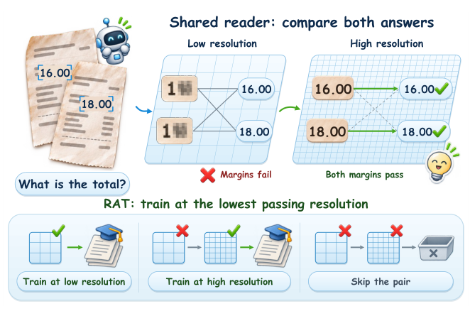
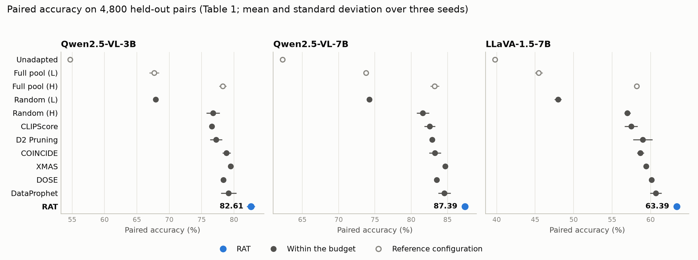
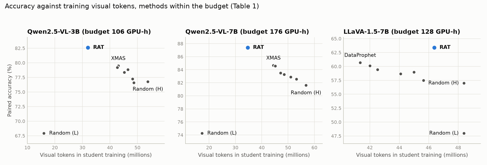
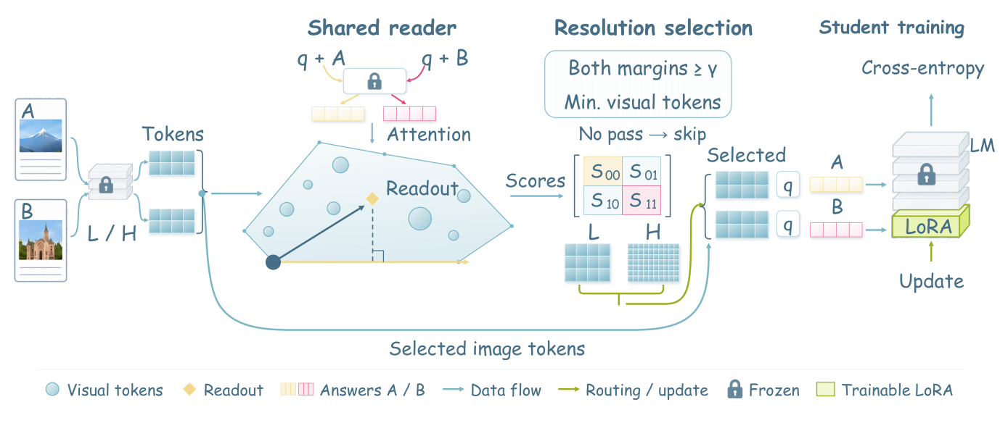
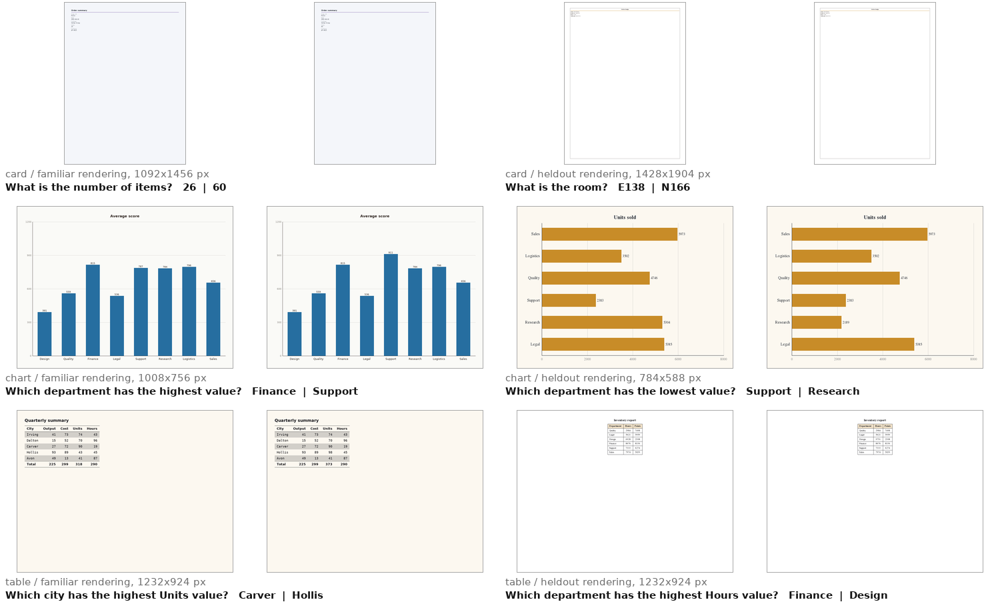
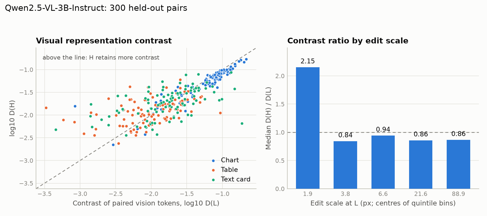
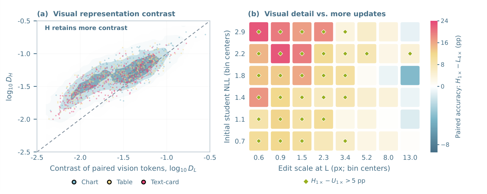
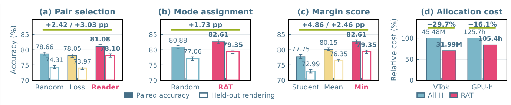
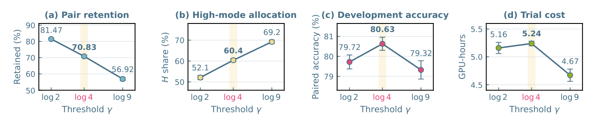
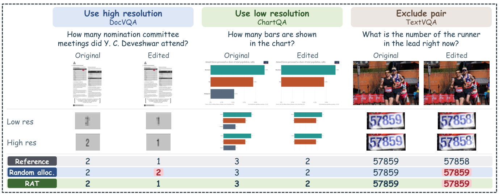

<h1 align="center">RAT</h1>

<p align="center">
  <b>Training Vision-Language Models with Margin-Based Resolution Selection</b><br>
  Official implementation of RAT (<b>R</b>epresentation-<b>A</b>ware <b>T</b>raining)
</p>

<p align="center">
  <a href="#citation"></a>
  <a href="pyproject.toml"></a>
  <a href="LICENSE"></a>
  <a href="https://github.com/OdurShi/rat/actions/workflows/ci.yml"></a>
  <a href="https://github.com/astral-sh/ruff"></a>
</p>

<p align="center">
  <a href="#main-results">Main results</a> ·
  <a href="#quick-start">Quick start</a> ·
  <a href="#data">Data</a> ·
  <a href="#reproducing-the-paper">Reproduce</a> ·
  <a href="#running-on-one-gpu-or-a-laptop">One GPU or a laptop</a> ·
  <a href="#method-to-code-map">Code map</a>
</p>

<p align="center">
  
</p>

Downsampling a chart or a document can erase the detail that determines the answer, while
training everything at high resolution spends visual tokens on answers that are already
clear at low resolution. RAT decides per example. It uses pairs of images that share a
question but differ in one detail that changes the answer; a lightweight reader on frozen
visual features scores both candidate answers for each image, and every pair is trained at
the cheapest resolution at which both correct answers win by a margin. Pairs that pass at no
resolution are skipped.

## Highlights

- **Higher paired accuracy within the same compute budget.** On 4,800 held-out pairs RAT
  reaches 82.61 / 87.39 / 63.39% on Qwen2.5-VL-3B / Qwen2.5-VL-7B / LLaVA-1.5-7B, 3.11 /
  2.72 / 2.70 points above the strongest of eight budget-matched baselines (Table 1).
- **About half the training visual tokens.** On the two Qwen backbones RAT trains with 53.3%
  and 49.3% fewer visual tokens than a full-pool high-resolution pass, and with 29.7% and
  27.1% fewer than the same pairs at high resolution (Tables 1 and 6).
- **The assignment itself matters.** With identical pairs and an identical token count,
  RAT's assignment beats a random assignment by 1.73 points overall and 2.29 points on
  held-out renderings (Table 4).
- **Transfers to natural benchmarks.** RAT has the best mean on all nine chart, text,
  document and OCR metrics of every backbone, including +1.17 / +0.80 / +1.74 points on the
  human-written questions of ChartQA (Tables 2 and 3).
- **Reproducible from this repository.** The pair generator with the manifests of all
  78,600 pairs, the three backbone interfaces, Algorithm S1 with budget accounting, every
  control of Table 4, the reported tables as CSV, a CPU quick start and laptop-scale
  configurations are included.

## Main results

Results reported in the paper; the figures are drawn from the CSV files in
[`results/paper`](results/paper) by `scripts/plot_results.py`.





**Table 1 of the paper.** Pair is the share of 4,800 held-out pairs with both answers
correct (%), GPU-h the total adaptation cost including preparation, tuning, selection and
training, VTok the visual tokens of the final student training in millions. Budgets are
106, 176 and 128 GPU-hours; inference uses the high-resolution mode for every method.
Mean ± standard deviation over three seeds.

<!-- table:T1 -->
| Method | Qwen2.5-VL-3B: Pair | Qwen2.5-VL-3B: GPU-h | Qwen2.5-VL-3B: VTok (M) | Qwen2.5-VL-7B: Pair | Qwen2.5-VL-7B: GPU-h | Qwen2.5-VL-7B: VTok (M) | LLaVA-1.5-7B: Pair | LLaVA-1.5-7B: GPU-h | LLaVA-1.5-7B: VTok (M) |
|---|---:|---:|---:|---:|---:|---:|---:|---:|---:|
| Unadapted | 54.69 | 0.0 | 0.00 | 62.27 | 0.0 | 0.00 | 39.77 | 0.0 | 0.00 |
| Full pool (L) | 67.67 ± 0.76 | 47.1 ± 0.1 | 18.51 | 73.76 ± 0.32 | 75.2 ± 0.0 | 18.51 | 45.48 ± 0.50 | 124.1 ± 0.1 | 57.60 |
| Full pool (H) | 78.27 ± 0.58 | 106.0 | 68.44 | 83.24 ± 0.62 | 176.0 | 68.44 | 58.19 ± 0.15 | 128.0 | 57.60 |
| Random (L) | 67.91 ± 0.42 | 54.7 ± 0.1 | 16.02 ± 0.07 | 74.25 ± 0.25 | 87.2 ± 0.2 | 17.31 ± 0.26 | 47.97 ± 0.45 | 119.7 ± 0.3 | 48.39 ± 0.05 |
| Random (H) | 76.76 ± 1.02 | 99.7 ± 0.4 | 53.76 ± 0.13 | 81.60 ± 0.85 | 170.9 ± 0.1 | 56.78 ± 0.08 | 56.99 ± 0.42 | 120.2 ± 0.2 | 48.40 ± 0.04 |
| CLIPScore | 76.60 ± 0.13 | 102.4 ± 0.2 | 48.70 ± 0.18 | 82.55 ± 0.75 | 171.6 ± 0.0 | 53.19 ± 0.25 | 57.48 ± 0.84 | 124.4 ± 0.3 | 45.64 ± 0.08 |
| D2 Pruning | 77.24 ± 0.94 | 103.4 ± 0.1 | 48.18 ± 0.12 | 82.88 ± 0.36 | 173.4 ± 0.2 | 50.97 ± 0.14 | 58.99 ± 1.25 | 123.4 ± 0.1 | 45.00 ± 0.05 |
| COINCIDE | 78.85 ± 0.63 | 104.0 ± 0.1 | 46.51 ± 0.21 | 83.28 ± 0.82 | 174.0 ± 0.3 | 48.48 ± 0.11 | 58.68 ± 0.45 | 126.2 ± 0.2 | 44.09 ± 0.01 |
| XMAS | 79.50 ± 0.18 | 105.4 ± 0.2 | 43.03 ± 0.18 | 84.67 ± 0.23 | 173.2 ± 0.4 | 44.44 ± 0.28 | 59.44 ± 0.21 | 125.0 ± 0.4 | 42.52 ± 0.06 |
| DOSE | 78.38 ± 0.34 | 103.7 ± 0.1 | 45.20 ± 0.25 | 83.51 ± 0.28 | 174.6 ± 0.1 | 47.18 ± 0.25 | 60.12 ± 0.23 | 126.3 ± 0.2 | 42.01 ± 0.04 |
| DataProphet | 79.18 ± 1.20 | 104.4 ± 0.2 | 42.68 ± 0.08 | 84.57 ± 0.85 | 175.1 ± 0.3 | 45.12 ± 0.50 | 60.69 ± 0.76 | 127.1 ± 0.2 | 41.34 ± 0.06 |
| **RAT** | **82.61 ± 0.63** | 105.4 ± 0.3 | 31.99 ± 0.24 | **87.39 ± 0.34** | 175.1 ± 0.3 | 34.68 ± 0.08 | **63.39 ± 0.39** | 127.4 ± 0.3 | 46.38 ± 0.03 |
<!-- /table:T1 -->

## Method

A training pair is two images with a shared question and different answers. The frozen
preprocessing, visual encoder and connector give the visual tokens of each image in a
low-resolution mode `L` and a high-resolution mode `H`; the frozen language backbone encodes
the question with each candidate answer.

* **Shared reader** (Eq. (1), (2)). One attention readout with two matrices pools the visual
  tokens with candidate-specific attention and scores the result. It is fitted once on a
  separate pool and then frozen.
* **Minimum-margin routing** (Eq. (3), (4)). For each image the margin is the score of its
  correct answer minus the score of the other answer. A pair passes a mode when the smaller
  of its two margins reaches the threshold `γ`; it is trained in the passing mode with the
  fewest visual tokens and excluded if no mode passes.
* **Student adaptation** (Eq. (5), Algorithm S1). The retained pairs are trained once with
  answer-only cross-entropy on language-side LoRA. Reader fitting, threshold trials, feature
  extraction, routing and updates share one GPU-time budget.

<p align="center">
  
</p>

## Installation

Python 3.10 or newer. With [uv](https://docs.astral.sh/uv/):

```bash
git clone https://github.com/OdurShi/rat.git && cd rat
uv venv --python 3.11 .venv
uv pip install -p .venv/bin/python -e ".[dev]"                  # library, tests, linter
uv pip install -p .venv/bin/python -e ".[hf,plots]" torchvision  # real backbones, figures
```

With pip:

```bash
python -m venv .venv && source .venv/bin/activate
pip install -e ".[dev]"            # add ",hf,plots" and torchvision for the real backbones
```

The import package is `rat`; the distribution is named `rat-vlm`. The core (data generator,
reader, routing, budget accounting, tiny backbone) needs only NumPy, Pillow, PyYAML and
PyTorch. The code is developed against PyTorch 2.15, Transformers 5.23 and PEFT 0.21.

## Quick start

Fits the reader and routes 600 generated pairs on a simulated visual interface, in which the
evidence for an answer grows with the size of the edit in the pixels of the input mode.
Nothing is downloaded and no GPU is needed; it takes a few seconds on a laptop CPU.

```bash
rat demo
```

Output:

```text
Pair train-00001 (table, 1232 x 924 px, 130 edited pixels)
  question: What is the Orders value for Aug?
  answers:  '76.0' (image 0)  vs  '78.0' (image 1)
Visual tokens per image (L / H):
  Qwen2.5-VL   234 / 972
  LLaVA-1.5    576 / 576
  SmolVLM       64 / 320

Reader fitted on 600 pairs (simulated interface): loss 0.693 -> 0.108
Held-out pairs: 600 (46 with edit scale < 2 px at L, 293 above 7 px)

  gamma   retained   H share   tokens saved   small edits: skip / L / H    large edits: skip / L / H
  log 2     75.2%     11.1%         61.5%            35% / 22% / 43%             23% / 76% / 1%
  log 4     67.3%     14.9%         58.6%             50% / 7% / 43%             29% / 69% / 2%
  log 9     59.0%     18.6%         55.9%             54% / 4% / 41%             37% / 61% / 2%

Done in 3s.  Tokens are counted with the Qwen2.5-VL geometry of the real pairs.
```

Small edits are routed to the high-resolution mode or skipped, large edits are trained at
low resolution, and a stricter threshold keeps fewer pairs with a larger share at high
resolution. Two more commands work without a model:

```bash
rat geometry --width 1456 --height 896     # visual tokens per backbone and mode
rat pairs --pool test --count 6            # render pairs to data/rendered/
```

## Data

The generator renders bar charts, numerical tables and text cards. A scene holds structured
content, a rendering specification and a question whose answer is computed from the content;
an edit changes one answer-determining variable and every dependent element, and a pair is
kept only if both renderings pass the consistency checks of Appendix B.1.



The manifests of all pools are shipped in [`data/manifests`](data/manifests) with the sizes
of Appendix E.1; each record regenerates its pair from the scene seed.

| Pool | Pairs | Use |
|---|---:|---|
| `reader_fit` | 10,000 | fitting the shared reader |
| `tune` | 5,000 | threshold trials |
| `dev` | 2,000 | development evaluation |
| `train` | 50,000 | student candidate pool |
| `test` | 4,800 | paired test set, half with held-out fonts, layouts and numerical ranges |
| `prelim_train` / `prelim_test` | 2,000 / 4,800 | preliminary study |

[`data/README.md`](data/README.md) documents the record format, the sample images, the
statistics of the pools and the fonts.

## Reproducing the paper

The paper uses Qwen2.5-VL-3B/7B-Instruct and LLaVA-1.5-7B on eight NVIDIA A100 80 GB GPUs
with bfloat16. All settings of Section 5.1 and Appendix E are the defaults of
[`configs/base.yaml`](configs/base.yaml); [`configs/backbones`](configs/backbones) adds the
backbone and its budget. Every run is stored as one JSON file and existing files are
skipped, so commands can be repeated to resume.

```bash
CONFIG=configs/backbones/qwen2.5-vl-3b.yaml      # or qwen2.5-vl-7b.yaml, llava-1.5-7b.yaml
python scripts/cache_features.py --config $CONFIG
python scripts/run_study.py --config $CONFIG --output runs/qwen3b \
    --stages main controls references variants preliminary --prelim-h4
python scripts/report_study.py --runs runs/qwen3b --config $CONFIG --output results/qwen3b
```

<details>
<summary><b>Commands for every table and figure of the paper</b></summary>

| Paper item | Command | Code |
|---|---|---|
| Table 1 (RAT, Random L/H, Full pool L/H, Unadapted), Table S3 (paired diagnostics) | `run_study.py --stages main references`, then `report_study.py` (`main.csv`) | `Study.run_gated`, `run_random`, `run_unadapted` |
| Table 1 (CLIPScore, D2 Pruning, COINCIDE, XMAS, DOSE, DataProphet) | selection rules on features of the proxy models | `rat/selection/baselines.py` |
| Tables 2, 3, S4 and the general-capability columns of Table S3 | `run_study.py --save-adapters`, then `eval_benchmark.py --benchmark chartqa --adapter <run>.adapter.pt` | `rat/evaluation/benchmarks.py` |
| Table 4, Figure 4 | `run_study.py --stages main controls variants`, then `report_study.py` (`main.csv`, `comparisons.csv`) | `Study.controls_on_retained`, `run_allocation_only`, `run_gated(rule="mean")`, `run_gated(source="student")` |
| Tables 5 and 6 | cost and exposure columns of `main.csv` | `CostLedger`, `token_saving_percent` |
| Table S5, Figure 5 | threshold trials in `report.md` | `select_threshold` |
| Figure 2a, Table S1 (contrast) | `reader_study.py --config $CONFIG --output results/reader_study/qwen3b` | `rat/analysis/contrast.py` |
| Figure 2b, Table S1 (accuracy) | `run_study.py --stages preliminary --prelim-h4`, then `report_study.py` (`preliminary.csv`) | `Study.run_preliminary`, `heatmap_cells` |
| Appendix E.1 (pools) | `build_manifests.py`, `make_data_card.py` | `rat/data` |

</details>

Single stages can be selected with `--stages` and `--seeds`, and any setting can be
overridden with `--set key=value`, for example `--set student.learning_rate=1e-4`.

## Running on one GPU or a laptop

Two configurations in [`configs/laptop`](configs/laptop) run on a single consumer GPU or an
Apple-silicon laptop. Features of the frozen visual interface are cached once
(`cache/`), so repeated runs only pay for the reader and the student.

**Frozen-side study with the paper's backbone.** Encodes a reader-fitting pool and a
held-out pool with Qwen2.5-VL-3B in both modes, measures the paired-token contrast by edit
scale (Fig. 2a), fits the shared reader and applies the routing rule for the three
thresholds (Fig. 5a, 5b). No student is trained; `--student` adds the paired accuracy of the
unadapted model.

```bash
python scripts/reader_study.py --config configs/laptop/qwen2.5-vl-3b_reader.yaml \
    --output results/reader_study/qwen2.5-vl-3b --student
python scripts/plot_reader_study.py results/reader_study/qwen2.5-vl-3b --panels contrast
```

<p align="center">
  
</p>

On 300 held-out pairs of the tuning pool, the high-resolution mode of Qwen2.5-VL-3B keeps a
median of 3.27 times the paired-token contrast of the low-resolution mode when the edit is
smaller than two pixels at `L`, and 0.86 times when it is larger than seven pixels (Table S1
of the paper: 2.70 and 1.07).

**Complete pipeline with a 256M backbone.** SmolVLM-256M makes student training affordable
without a data-centre GPU: the preliminary study, RAT with its threshold trials, the uniform
baselines and the matched controls run from one command per stage.

```bash
CONFIG=configs/laptop/smolvlm_256m.yaml
python scripts/cache_features.py --config $CONFIG
python scripts/run_study.py --config $CONFIG --output runs/laptop --stages preliminary main controls
python scripts/report_study.py --runs runs/laptop --config $CONFIG --output results/laptop_study/smolvlm-256m
```

The outputs of the runs made with this repository are stored in [`results/`](results) and
described in [`docs/implementation_notes.md`](docs/implementation_notes.md#5-record-of-executed-runs).

## What this repository adds

- **A tiled backbone for laptops.** SmolVLM-256M/500M is supported beside the paper's
  backbones; `L` is its single 512-pixel view and `H` adds 512-pixel tiles.
- **Resolution ladders.** Routing accepts any number of modes; the lazy rule stays exact.
- **Feature standardisation for the reader**, a switch that removes the dependence of
  reader fitting on the scale of the backbone's features.
- **Paired uncertainty.** A paired bootstrap interval and an exact McNemar test for the
  difference between two methods on the shared test pairs.
- **A frozen-side study** that measures visual contrast, reader margins and routing
  statistics on a new backbone without training a student.
- **Consistency checks of the reported numbers** (`rat check-paper`).

[`docs/implementation_notes.md`](docs/implementation_notes.md) describes each addition.

## Method-to-code map

| Paper | Code |
|---|---|
| Pairs, scenes, edits, consistency checks (Sec. 4.1, App. B.1) | `src/rat/data/`: `scenes.py`, `render.py`, `checks.py`, `pairs.py` |
| Pools and manifests (App. E.1) | `src/rat/data/splits.py` |
| Input modes and token counts (Sec. 4.1, App. E.4) | `src/rat/interface/geometry.py` |
| Qwen2.5-VL, LLaVA-1.5 and SmolVLM interfaces, LoRA, greedy decoding | `src/rat/backbones/hf.py` |
| Eq. (S4), (S5), (1), (2): shared reader | `src/rat/reader.py` |
| Eq. (3), (S6): margins, decomposition, thresholds | `src/rat/margins.py` |
| Eq. (4), App. C.2: routing, random allocation within strata | `src/rat/routing.py` |
| Eq. (S8), App. D.2: ledger, cost model, reservation | `src/rat/budget.py` |
| Algorithm S1, App. D.1: routing with reservation, threshold selection | `src/rat/pipeline.py` |
| Eq. (5), App. E.4: student adaptation | `src/rat/student.py` |
| Tables 1 and 4: methods and controls | `src/rat/experiments.py`, `src/rat/selection/baselines.py` |
| Eq. (S2), (S3), (S7), (S9), (S10): paired metrics | `src/rat/evaluation/paired.py` |
| Table S2: benchmark metrics | `src/rat/evaluation/benchmarks.py` |
| Eq. (S1), App. A: contrast, edit scale, heat-map cells | `src/rat/analysis/contrast.py` |

The complete map and the choices for details the paper leaves open are in
[`docs/implementation_notes.md`](docs/implementation_notes.md).

## Full results

The tables and figures in this section are the results reported in the paper.

<p align="center">
  
</p>

<details>
<summary><b>Table S1: one high-resolution pass against four low-resolution passes</b></summary>

Qwen2.5-VL-3B, 2,000 training pairs, 4,800 test pairs at fixed `H` input; accuracies (%) and
differences (pp) are means over three runs.

<!-- table:S1 -->
| Statistic | Small edits (s < 2) | Large edits (s > 7) |
|---|---:|---:|
| Pairs | 1945 | 1085 |
| Median D_H / D_L | 2.70 | 1.07 |
| L1× accuracy | 58.01 | 74.32 |
| L4× accuracy | 61.80 | 78.43 |
| U1× accuracy | 60.41 | 78.16 |
| H1× accuracy | 76.26 | 79.05 |
| H4× accuracy | 79.81 | 83.99 |
| H1× − L4× | 14.46 | 0.61 |
| H1× − U1× | 15.85 | 0.89 |
| H1× − L1× | 18.25 | 4.73 |
| H4× − L4× | 18.01 | 5.56 |
<!-- /table:S1 -->

</details>

<details>
<summary><b>Tables 2 and 3: transfer to natural benchmarks</b></summary>

Means over three seeds at fixed `H` inference; DocVQA and InfoVQA are 100 × ANLS, OCRBench v1
is on a 0-1,000 scale. Standard deviations are in
[`results/paper/tableS4_transfer.csv`](results/paper/tableS4_transfer.csv).

Qwen2.5-VL-3B-Instruct

<!-- table:T2a -->
| Method | ChartQA human | ChartQA aug. | ChartQAPro | TextVQA | DocVQA | InfoVQA | OCRBench v1 | OCRBench v2 EN | OCRBench v2 ZH |
|---|---:|---:|---:|---:|---:|---:|---:|---:|---:|
| Unadapted | 73.60 | 94.40 | 39.00 | 79.30 | 93.90 | 77.10 | 797.0 | 54.30 | 52.10 |
| Full pool (L) | 74.21 | 94.53 | 39.78 | 79.14 | 93.53 | 76.89 | 794.7 | 54.17 | 51.91 |
| Full pool (H) | 75.92 | 95.44 | 41.65 | 80.25 | 94.26 | 77.83 | 807.0 | 55.06 | 52.78 |
| Random (L) | 74.03 | 94.53 | 39.99 | 79.04 | 93.56 | 76.62 | 792.3 | 53.96 | 51.63 |
| Random (H) | 75.07 | 94.99 | 40.25 | 79.77 | 93.63 | 77.43 | 800.0 | 54.76 | 52.41 |
| CLIPScore | 75.44 | 94.88 | 40.35 | 79.73 | 93.93 | 77.33 | 801.3 | 54.65 | 52.33 |
| D2 Pruning | 75.25 | 95.31 | 40.69 | 79.62 | 94.00 | 77.55 | 801.0 | 54.95 | 52.53 |
| COINCIDE | 75.33 | 95.44 | 40.74 | 80.01 | 93.86 | 77.76 | 805.0 | 55.01 | 52.66 |
| XMAS | 75.63 | 95.31 | 40.97 | 80.11 | 93.98 | 77.76 | 805.0 | 55.09 | 52.62 |
| DOSE | 75.31 | 95.33 | 40.88 | 80.18 | 93.97 | 77.75 | 805.3 | 55.21 | 52.81 |
| DataProphet | 75.71 | 95.28 | 40.99 | 79.84 | 94.26 | 78.05 | 806.3 | 55.42 | 52.91 |
| **RAT** | **76.88** | **96.08** | **41.81** | **80.55** | **94.54** | **78.43** | **811.3** | **55.85** | **53.47** |
<!-- /table:T2a -->

Qwen2.5-VL-7B-Instruct

<!-- table:T2b -->
| Method | ChartQA human | ChartQA aug. | ChartQAPro | TextVQA | DocVQA | InfoVQA | OCRBench v1 | OCRBench v2 EN | OCRBench v2 ZH |
|---|---:|---:|---:|---:|---:|---:|---:|---:|---:|
| Unadapted | 79.3 | 95.3 | 45.60 | 84.90 | 95.70 | 82.60 | 864.0 | 56.30 | 57.20 |
| Full pool (L) | 79.89 | 95.44 | 46.27 | 84.74 | 95.48 | 82.40 | 859.0 | 56.07 | 57.14 |
| Full pool (H) | 81.07 | 95.84 | 47.27 | 85.42 | 95.61 | 83.10 | 871.7 | 57.01 | 57.48 |
| Random (L) | 79.47 | 95.73 | 45.90 | 84.52 | 95.43 | 82.47 | 858.0 | 56.08 | 56.88 |
| Random (H) | 80.48 | 95.84 | 46.97 | 84.88 | 95.67 | 82.87 | 866.3 | 56.63 | 57.51 |
| CLIPScore | 80.37 | 95.81 | 46.73 | 85.25 | 95.48 | 83.01 | 867.7 | 56.78 | 57.44 |
| D2 Pruning | 80.61 | 95.89 | 46.97 | 85.36 | 95.91 | 82.99 | 870.3 | 56.97 | 57.38 |
| COINCIDE | 80.59 | 95.84 | 46.91 | 85.21 | 95.74 | 83.04 | 869.7 | 56.91 | 57.80 |
| XMAS | 80.88 | 96.03 | 47.07 | 85.33 | 95.83 | 83.07 | 869.3 | 56.92 | 57.79 |
| DOSE | 80.72 | 95.81 | 47.43 | 85.43 | 95.51 | 83.17 | 870.0 | 57.18 | 57.91 |
| DataProphet | 80.91 | 96.11 | 47.61 | 85.36 | 96.00 | 83.24 | 870.7 | 57.26 | 57.70 |
| **RAT** | **81.71** | **96.59** | **48.24** | **85.83** | **96.16** | **83.63** | **879.0** | **57.76** | **58.44** |
<!-- /table:T2b -->

LLaVA-1.5-7B

<!-- table:T3 -->
| Method | ChartQA human | ChartQA aug. | ChartQAPro | TextVQA | DocVQA | InfoVQA | OCRBench v1 | OCRBench v2 EN | OCRBench v2 ZH |
|---|---:|---:|---:|---:|---:|---:|---:|---:|---:|
| Unadapted | 14.3 | 22.1 | 8.90 | 58.20 | 28.10 | 19.80 | 206.0 | 11.30 | 7.40 |
| Full pool (L) | 15.39 | 23.55 | 9.63 | 58.31 | 28.10 | 19.71 | 204.0 | 11.56 | 7.23 |
| Full pool (H) | 18.64 | 27.95 | 11.30 | 59.57 | 29.18 | 20.61 | 220.7 | 12.19 | 7.93 |
| Random (L) | 15.31 | 23.71 | 9.35 | 58.02 | 28.13 | 19.66 | 203.0 | 11.32 | 7.33 |
| Random (H) | 18.21 | 26.91 | 11.34 | 59.26 | 28.89 | 20.32 | 217.0 | 11.76 | 7.78 |
| CLIPScore | 18.51 | 27.17 | 11.24 | 59.20 | 28.86 | 20.34 | 219.7 | 11.95 | 7.66 |
| D2 Pruning | 18.61 | 27.28 | 11.16 | 59.49 | 28.83 | 20.42 | 217.3 | 11.86 | 8.04 |
| COINCIDE | 19.15 | 27.33 | 11.49 | 59.74 | 28.98 | 20.45 | 222.0 | 12.07 | 7.87 |
| XMAS | 19.25 | 27.60 | 11.46 | 59.77 | 28.93 | 20.48 | 219.3 | 12.26 | 7.91 |
| DOSE | 19.39 | 27.47 | 11.79 | 59.71 | 29.13 | 20.76 | 220.7 | 12.51 | 8.06 |
| DataProphet | 19.49 | 27.97 | 11.43 | 59.77 | 29.29 | 20.84 | 222.3 | 12.25 | 8.09 |
| **RAT** | **21.23** | **29.63** | **12.29** | **60.73** | **29.85** | **21.54** | **227.7** | **12.91** | **8.75** |
<!-- /table:T3 -->

</details>

<details open>
<summary><b>Table 4 and Figure 4: filtering, allocation and score controls on Qwen2.5-VL-3B</b></summary>

<p align="center">
  
</p>

<!-- table:T4 -->
| Control | Pairs (k) | H (%) | Pair | Collapse ↓ | Held-out | Worst | GPU-h | VTok (M) |
|---|---:|---:|---:|---:|---:|---:|---:|---:|
| **RAT (complete exposure)** | 33.10 ± 0.10 | 59.8 ± 0.6 | **82.61 ± 0.63** | **5.51 ± 0.08** | **79.35 ± 0.54** | **76.46 ± 0.47** | 105.4 ± 0.3 | 31.99 ± 0.24 |
| Filtering-only: S_R, all H | 33.10 ± 0.10 | 100 | 81.08 ± 0.55 | 6.05 ± 0.19 | 78.10 ± 0.56 | 74.92 ± 0.72 | 125.7 ± 0.5 | 45.48 ± 0.19 |
| Allocation-only: full pool | 50.0 | 72.0 ± 0.4 | 79.43 ± 0.55 | 6.70 ± 0.26 | 75.81 ± 0.54 | 72.96 ± 0.58 | 142.3 ± 0.6 | 54.42 ± 0.25 |
| Random allocation: S_R | 33.10 ± 0.10 | 59.8 ± 0.6 | 80.88 ± 0.42 | 6.12 ± 0.23 | 77.06 ± 0.62 | 73.92 ± 0.47 | 105.6 ± 0.4 | 31.99 ± 0.24 |
| Mean branch margin | 36.62 ± 0.24 | 55.2 ± 0.7 | 80.15 ± 0.45 | 6.42 ± 0.19 | 76.35 ± 0.43 | 73.17 ± 0.58 | 105.2 ± 0.3 | 34.25 ± 0.28 |
| Initial-student candidate margin | 29.47 ± 0.31 | 66.5 ± 0.9 | 77.75 ± 0.69 | 8.55 ± 0.45 | 72.99 ± 0.62 | 69.38 ± 0.70 | 104.8 ± 0.4 | 31.15 ± 0.23 |
| Equal-count random, all H | 33.10 ± 0.10 | 100 | 78.66 ± 0.48 | 6.82 ± 0.23 | 74.31 ± 0.52 | 70.83 ± 0.59 | 72.4 ± 0.3 | 45.35 ± 0.19 |
| Equal-count answer loss, all H | 33.10 ± 0.10 | 100 | 78.05 ± 0.56 | 7.10 ± 0.23 | 73.97 ± 0.41 | 70.75 ± 0.54 | 109.6 ± 0.7 | 45.60 ± 0.17 |
<!-- /table:T4 -->

</details>

<details>
<summary><b>Tables 5 and 6: cost decomposition and token savings</b></summary>

GPU-hours of RAT (mean ± sd over the main runs):

<!-- table:T5 -->
| Backbone | Preparation | Routing | Training | Total |
|---|---:|---:|---:|---:|
| Qwen2.5-VL-3B | 27.1 ± 0.1 | 24.9 ± 0.3 | 53.4 ± 0.1 | 105.4 ± 0.3 |
| Qwen2.5-VL-7B | 46.3 ± 0.2 | 38.1 ± 0.3 | 90.7 ± 0.2 | 175.1 ± 0.3 |
| LLaVA-1.5-7B | 31.4 ± 0.2 | 18.5 ± 0.4 | 77.5 ± 0.3 | 127.4 ± 0.3 |
<!-- /table:T5 -->

Token savings from input allocation at fixed exposure:

<!-- table:T6 -->
| Backbone | Trained pairs (k) | H (%) | Actual VTok (M) | Same-pair H (M) | Saved (%) |
|---|---:|---:|---:|---:|---:|
| Qwen2.5-VL-3B | 33.10 ± 0.10 | 59.8 ± 0.6 | 31.99 ± 0.24 | 45.48 ± 0.19 | 29.7 ± 0.2 |
| Qwen2.5-VL-7B | 34.75 ± 0.15 | 62.4 ± 0.4 | 34.68 ± 0.08 | 47.56 ± 0.22 | 27.1 ± 0.2 |
| LLaVA-1.5-7B | 40.26 ± 0.03 | 71.1 ± 1.3 | 46.38 ± 0.03 | 46.38 ± 0.03 | 0 |
<!-- /table:T6 -->

</details>

<details>
<summary><b>Table S5 and Figure 5: threshold sensitivity on Qwen2.5-VL-3B</b></summary>

<p align="center">
  
</p>

<!-- table:S5 -->
| γ | Retained (%) | H (%) | Dev Pair | Trial GPU-h |
|---|---:|---:|---:|---:|
| log 2 | 81.47 ± 0.60 | 52.1 ± 1.0 | 79.72 ± 0.35 | 5.16 ± 0.10 |
| log 4 | 70.83 ± 0.74 | 60.4 ± 0.8 | **80.63 ± 0.33** | 5.24 ± 0.04 |
| log 9 | 56.92 ± 1.10 | 69.2 ± 0.9 | 79.32 ± 0.46 | 4.67 ± 0.11 |
<!-- /table:S5 -->

</details>

<details>
<summary><b>Table S3: paired-test diagnostics and broader transfer</b></summary>

Qwen2.5-VL-3B-Instruct

<!-- table:S3a -->
| Method | Single | Collapse ↓ | Familiar pair | Held-out pair | Worst pair | MathVista | MMBench | POPE random | POPE popular | POPE adv. |
|---|---:|---:|---:|---:|---:|---:|---:|---:|---:|---:|
| Unadapted | 70.81 | 13.65 | 57.42 | 51.96 | 50.38 | **62.30** | **78.0** | **88.20** | **86.90** | **85.60** |
| Full pool (L) | 79.00 ± 0.54 | 10.80 ± 0.27 | 70.75 ± 0.36 | 64.60 ± 1.17 | 62.29 ± 1.35 | 60.87 ± 0.12 | 77.06 ± 0.09 | 87.08 ± 0.26 | 85.27 ± 0.13 | 83.78 ± 0.27 |
| Full pool (H) | 86.16 ± 0.45 | 7.12 ± 0.51 | 80.97 ± 0.67 | 75.57 ± 0.51 | 73.04 ± 0.62 | 61.47 ± 0.06 | 77.38 ± 0.18 | 87.37 ± 0.20 | 85.63 ± 0.19 | 84.13 ± 0.21 |
| Random (L) | 79.51 ± 0.59 | 10.38 ± 0.13 | 70.65 ± 1.04 | 65.17 ± 0.65 | 62.62 ± 1.57 | 61.00 ± 0.36 | 76.98 ± 0.31 | 86.57 ± 0.22 | 85.43 ± 0.06 | 83.73 ± 0.20 |
| Random (H) | 84.97 ± 0.62 | 7.58 ± 0.37 | 79.10 ± 0.68 | 74.43 ± 1.36 | 70.67 ± 2.53 | 61.10 ± 0.26 | 77.18 ± 0.22 | 87.07 ± 0.10 | 85.48 ± 0.01 | 83.94 ± 0.09 |
| CLIPScore | 84.89 ± 0.21 | 7.40 ± 0.53 | 79.46 ± 0.56 | 73.75 ± 0.80 | 72.08 ± 1.04 | 61.73 ± 0.55 | 77.49 ± 0.23 | 87.32 ± 0.25 | 85.65 ± 0.17 | 84.10 ± 0.11 |
| D2 Pruning | 85.18 ± 0.60 | 7.31 ± 0.46 | 80.03 ± 1.73 | 74.44 ± 0.88 | 70.50 ± 0.54 | 61.17 ± 0.31 | 77.46 ± 0.39 | 87.13 ± 0.16 | 85.80 ± 0.17 | 84.22 ± 0.09 |
| COINCIDE | 86.40 ± 0.33 | 6.83 ± 0.71 | 82.31 ± 0.48 | 75.39 ± 1.06 | 73.33 ± 0.64 | 61.77 ± 0.23 | 77.69 ± 0.28 | 87.14 ± 0.14 | 85.82 ± 0.09 | 84.46 ± 0.16 |
| XMAS | 86.66 ± 0.05 | 6.96 ± 0.31 | 82.54 ± 0.64 | 76.46 ± 0.94 | 74.67 ± 1.89 | 61.60 ± 0.17 | 77.43 ± 0.10 | 87.41 ± 0.26 | 86.06 ± 0.20 | 84.39 ± 0.14 |
| DOSE | 86.01 ± 0.41 | 7.17 ± 0.57 | 81.28 ± 0.72 | 75.47 ± 0.46 | 73.12 ± 1.08 | 61.57 ± 0.15 | 77.43 ± 0.22 | 87.77 ± 0.13 | 85.91 ± 0.25 | 84.48 ± 0.09 |
| DataProphet | 86.53 ± 0.78 | 6.66 ± 0.41 | 82.12 ± 0.98 | 76.24 ± 1.46 | 74.17 ± 1.35 | 61.93 ± 0.31 | 77.38 ± 0.13 | 87.64 ± 0.06 | 86.09 ± 0.24 | 84.78 ± 0.07 |
| **RAT** | **88.86 ± 0.33** | **5.51 ± 0.08** | **85.88 ± 1.05** | **79.35 ± 0.54** | **76.46 ± 0.47** | 61.93 ± 0.21 | 77.86 ± 0.13 | 87.82 ± 0.06 | 86.63 ± 0.27 | 85.28 ± 0.09 |
<!-- /table:S3a -->

Qwen2.5-VL-7B-Instruct

<!-- table:S3b -->
| Method | Single | Collapse ↓ | Familiar pair | Held-out pair | Worst pair | MathVista | MMBench | POPE random | POPE popular | POPE adv. |
|---|---:|---:|---:|---:|---:|---:|---:|---:|---:|---:|
| Unadapted | 75.69 | 12.54 | 65.25 | 59.29 | 57.00 | **68.20** | **82.6** | **89.50** | **88.40** | **86.90** |
| Full pool (L) | 82.91 ± 0.32 | 8.37 ± 0.22 | 77.04 ± 0.08 | 70.47 ± 0.73 | 68.38 ± 1.44 | 66.83 ± 0.49 | 81.84 ± 0.20 | 88.46 ± 0.08 | 87.01 ± 0.15 | 85.22 ± 0.08 |
| Full pool (H) | 89.15 ± 0.30 | 5.21 ± 0.51 | 86.47 ± 0.62 | 80.00 ± 0.66 | 78.08 ± 0.29 | 67.33 ± 0.06 | 82.02 ± 0.13 | 88.82 ± 0.05 | 87.26 ± 0.19 | 85.85 ± 0.09 |
| Random (L) | 83.59 ± 0.39 | 8.39 ± 0.45 | 77.57 ± 0.50 | 70.93 ± 0.02 | 68.38 ± 0.66 | 67.00 ± 0.44 | 81.50 ± 0.18 | 88.31 ± 0.19 | 86.94 ± 0.11 | 85.04 ± 0.17 |
| Random (H) | 88.14 ± 0.61 | 5.66 ± 0.49 | 85.26 ± 1.14 | 77.94 ± 0.71 | 75.46 ± 0.26 | 67.33 ± 0.15 | 82.02 ± 0.25 | 88.39 ± 0.11 | 87.29 ± 0.16 | 85.43 ± 0.19 |
| CLIPScore | 88.74 ± 0.79 | 5.90 ± 0.28 | 85.97 ± 1.07 | 79.12 ± 0.58 | 76.92 ± 0.89 | 67.43 ± 0.15 | 82.10 ± 0.26 | 88.67 ± 0.28 | 87.51 ± 0.05 | 85.71 ± 0.16 |
| D2 Pruning | 88.91 ± 0.30 | 5.47 ± 0.38 | 85.54 ± 0.51 | 80.21 ± 1.21 | 77.79 ± 0.76 | 67.57 ± 0.38 | 81.82 ± 0.18 | 88.49 ± 0.13 | 87.27 ± 0.07 | 85.68 ± 0.13 |
| COINCIDE | 89.12 ± 0.53 | 5.15 ± 0.39 | 86.99 ± 0.63 | 79.58 ± 1.04 | 76.79 ± 1.37 | 67.83 ± 0.55 | 82.22 ± 0.15 | 88.64 ± 0.22 | 87.80 ± 0.13 | 85.68 ± 0.12 |
| XMAS | 90.08 ± 0.16 | 4.90 ± 0.41 | 87.56 ± 0.36 | 81.78 ± 0.57 | 78.88 ± 0.90 | 67.83 ± 0.25 | 82.19 ± 0.30 | 89.05 ± 0.26 | 87.45 ± 0.03 | 85.88 ± 0.24 |
| DOSE | 89.53 ± 0.25 | 5.17 ± 0.14 | 85.76 ± 0.48 | 81.25 ± 0.23 | 80.00 ± 0.76 | 67.83 ± 0.38 | 82.36 ± 0.26 | 88.89 ± 0.19 | 87.56 ± 0.06 | 85.89 ± 0.05 |
| DataProphet | 90.17 ± 0.53 | 4.70 ± 0.24 | 88.03 ± 0.70 | 81.11 ± 1.32 | 77.12 ± 2.18 | 67.63 ± 0.15 | 82.30 ± 0.15 | 88.82 ± 0.04 | 87.75 ± 0.20 | 86.07 ± 0.07 |
| **RAT** | **91.82 ± 0.21** | **4.02 ± 0.12** | **91.10 ± 0.23** | **83.68 ± 0.88** | **82.42 ± 1.02** | 68.03 ± 0.21 | 82.19 ± 0.18 | 89.39 ± 0.18 | 87.99 ± 0.22 | 86.63 ± 0.29 |
<!-- /table:S3b -->

LLaVA-1.5-7B

<!-- table:S3c -->
| Method | Single | Collapse ↓ | Familiar pair | Held-out pair | Worst pair | MathVista | MMBench | POPE random | POPE popular | POPE adv. |
|---|---:|---:|---:|---:|---:|---:|---:|---:|---:|---:|
| Unadapted | 61.22 | 19.56 | 42.21 | 37.33 | 36.25 | 26.70 | **64.3** | 84.60 | 83.30 | **82.50** |
| Full pool (L) | 64.42 ± 0.30 | 17.32 ± 0.76 | 48.25 ± 0.40 | 42.71 ± 0.63 | 41.12 ± 1.44 | 25.07 ± 0.21 | 62.57 ± 0.22 | 82.82 ± 0.20 | 81.26 ± 0.15 | 80.54 ± 0.21 |
| Full pool (H) | 72.85 ± 0.44 | 14.01 ± 0.32 | 60.50 ± 0.99 | 55.88 ± 0.72 | 53.46 ± 0.69 | 26.07 ± 0.21 | 63.52 ± 0.13 | 83.65 ± 0.25 | 82.34 ± 0.01 | 81.35 ± 0.23 |
| Random (L) | 66.76 ± 0.39 | 16.49 ± 0.15 | 50.65 ± 0.19 | 45.29 ± 0.94 | 42.67 ± 0.75 | 24.80 ± 0.30 | 62.69 ± 0.18 | 83.12 ± 0.17 | 81.56 ± 0.09 | 80.45 ± 0.16 |
| Random (H) | 72.17 ± 0.28 | 14.03 ± 0.66 | 59.49 ± 0.47 | 54.49 ± 1.10 | 52.17 ± 2.24 | 25.83 ± 0.21 | 63.52 ± 0.35 | 83.68 ± 0.06 | 82.06 ± 0.07 | 81.17 ± 0.08 |
| CLIPScore | 72.88 ± 0.55 | 13.51 ± 0.60 | 61.17 ± 0.25 | 53.79 ± 1.45 | 52.29 ± 0.81 | 25.93 ± 0.21 | 63.55 ± 0.36 | 83.69 ± 0.21 | 82.25 ± 0.20 | 81.19 ± 0.09 |
| D2 Pruning | 73.61 ± 0.49 | 13.28 ± 0.20 | 61.99 ± 0.71 | 55.99 ± 2.07 | 53.92 ± 1.16 | 25.50 ± 0.10 | 63.55 ± 0.22 | 83.55 ± 0.05 | 82.08 ± 0.26 | 81.35 ± 0.20 |
| COINCIDE | 73.43 ± 0.43 | 13.06 ± 0.85 | 61.47 ± 1.07 | 55.89 ± 0.87 | 53.54 ± 1.35 | 26.23 ± 0.15 | 63.66 ± 0.17 | 83.97 ± 0.18 | 82.22 ± 0.04 | 81.44 ± 0.25 |
| XMAS | 73.90 ± 0.48 | 13.05 ± 0.27 | 62.78 ± 0.53 | 56.11 ± 0.31 | 54.46 ± 0.14 | 26.00 ± 0.10 | 63.46 ± 0.18 | 83.68 ± 0.12 | 82.29 ± 0.20 | 81.39 ± 0.25 |
| DOSE | 74.10 ± 0.36 | 12.92 ± 0.50 | 63.64 ± 0.56 | 56.61 ± 0.13 | 53.96 ± 1.31 | 26.33 ± 0.23 | 63.89 ± 0.26 | 83.82 ± 0.36 | 82.27 ± 0.16 | 81.55 ± 0.22 |
| DataProphet | 74.58 ± 0.77 | 12.56 ± 0.65 | 63.99 ± 1.25 | 57.40 ± 0.60 | 54.96 ± 0.92 | 26.03 ± 0.42 | 64.09 ± 0.09 | 84.12 ± 0.31 | 82.43 ± 0.16 | 81.60 ± 0.13 |
| **RAT** | **76.62 ± 0.22** | **11.79 ± 0.24** | **66.10 ± 0.89** | **60.68 ± 0.93** | **57.71 ± 1.49** | **26.93 ± 0.50** | 64.20 ± 0.36 | **84.65 ± 0.18** | **83.37 ± 0.16** | 82.24 ± 0.34 |
<!-- /table:S3c -->

</details>

<details>
<summary><b>Figure 6: illustrative routing decisions</b></summary>

<p align="center">
  
</p>

</details>

## Repository layout

```text
assets/paper_figures/        figures of the paper and their captions
assets/results/              figures drawn from results/
configs/
  base.yaml                  paper defaults (Section 5.1, Appendix D and E)
  backbones/                 Qwen2.5-VL-3B/7B and LLaVA-1.5-7B with their budgets
  laptop/                    laptop-scale configurations
data/
  manifests/                 all seven pools (78,600 pairs)
  samples/                   twelve rendered pairs
docs/                        implementation notes and the record of the runs made here
results/paper/               the tables of the paper as CSV
results/                     outputs of the runs made with this repository
scripts/                     manifests, feature cache, study runner, reports, figures
src/rat/
  data/                      scenes, renderer, checks, pairs, pools, fonts
  interface/                 input modes and token geometry
  backbones/                 Qwen2.5-VL, LLaVA-1.5, SmolVLM and a tiny test backbone
  reader.py margins.py routing.py budget.py pipeline.py student.py experiments.py
  selection/                 selectors compared with RAT
  evaluation/                paired metrics, benchmark metrics, paired statistics
  analysis/                  contrast and edit scale
tests/                       unit tests per equation-level component and end-to-end tests
```

## Citation

The paper is under review. The BibTeX entry will be added here on publication.

## License

The code is released under the MIT license, see [LICENSE](LICENSE). The fonts in
`src/rat/data/fonts` keep their own licences (DejaVu and STIX), which are shipped with them.

## Acknowledgements

* Models: Qwen2.5-VL (Apache-2.0), LLaVA-1.5 (Apache-2.0 code, Llama 2 community licence for
  the weights), SmolVLM (Apache-2.0).
* Benchmarks: ChartQA, ChartQAPro, TextVQA, DocVQA, InfographicVQA, OCRBench, MathVista,
  MMBench and POPE.
* Libraries: PyTorch, Hugging Face Transformers and PEFT, Pillow.
